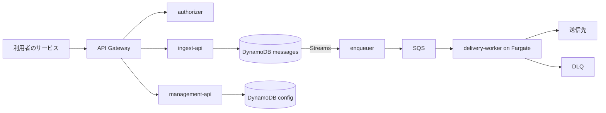

# Cloud Native Webhook Delivery

マルチテナント対応の Webhook 配信基盤です。利用者がイベントを API で送信すると、購読している送信先へ、署名付きで確実に届けます。失敗した配信は指数バックオフで再送し、再送しきれなかったものは DLQ に隔離します。

> 開発中です。この README は目標とする構成を説明しており、まだ実装されていない機能を含みます。

## 特徴

- **イベントを失いにくい受付**: Outbox パターンにより、保存と配信処理への受け渡しの間で障害が起きてもイベントを失いません
- **イベントタイプ購読**: 1 件のメッセージを、購読している複数の送信先へ配信します
- **送信先ごとの再送**: 約 27 時間で最大 8 回送信し、成功した送信先には再送しません
- **Standard Webhooks 準拠の署名**: HMAC-SHA256 で署名し、シークレットは無停止で更新できます
- **マルチテナント分離**: テナント単位の流量制限と Fair Queue により、他テナントの影響を抑えます
- **SSRF 対策**: 検査済みの IP にのみ接続し、内部ネットワークへの配信を拒否します
- **冪等な送信 API**: `Idempotency-Key` により、送信の再試行で配信が重複しません

## アーキテクチャ



設計の詳細は [docs/architecture.md](docs/architecture.md)、判断の理由は [docs/adr/](docs/adr/) を参照してください。

## 技術スタック

| 領域 | 採用技術 |
|---|---|
| 言語 | Go（単一モジュールのモノレポ） |
| AWS | API Gateway、Lambda、DynamoDB、SQS、EventBridge Scheduler、ECS Fargate、KMS |
| IaC | Terraform |
| CI/CD | GitHub Actions（OIDC 認証） |
| ローカル環境 | Docker Compose、DynamoDB Local、ElasticMQ |

## API の例

エンドポイントを登録し、発行された署名シークレットを受信側に設定します。

```http
POST /v1/endpoints
Authorization: Bearer <API キー>

{ "url": "https://example.com/webhook", "eventTypes": ["order.created"] }
```

メッセージを送信します。

```http
POST /v1/messages
Authorization: Bearer <API キー>
Idempotency-Key: 8f14e45f

{ "type": "order.created", "data": { "orderId": "123" } }
```

受信側には、次の形式で届きます。

```http
POST /webhook
webhook-id: msg_01J9Z3
webhook-timestamp: 1798600000
webhook-signature: v1,K5oZfzN95Z9UVu1EsfQmfVNQhnkZ2pj9o9NDN/H/pI4=

{ "type": "order.created", "timestamp": "2026-12-30T00:00:00Z", "data": { "orderId": "123" } }
```

配信は at-least-once です。同じ Webhook が複数回届く場合があるので、受信側は `webhook-id` で重複を判別してください。

## リポジトリ構成

```text
cmd/
  ingest-api/        メッセージの受付
  management-api/    エンドポイント、API キー、配信状況の管理
  authorizer/        API キーの検証
  enqueuer/          配信の生成と SQS への投入
  delivery-worker/   送信先への配信
  dummy-receiver/    動作確認用の受信サーバー
internal/
  core/              クラウドに依存しないドメインロジック
  adapters/aws/      AWS 向けのアダプタ
infra/
  bootstrap/         tfstate 用バケットと OIDC の準備
  aws/               Terraform モジュールと環境定義
scripts/             テナント作成などの運用スクリプト
loadtest/            負荷試験
docs/                設計文書と ADR
```

## 今後の拡張

- GCP 版のアダプタとインフラ
- テナントのセルフサインアップと管理画面
- 送信元 IP の固定（NAT Gateway）
- 失敗が続くエンドポイントの自動無効化
- 管理 API からのメッセージ再送
