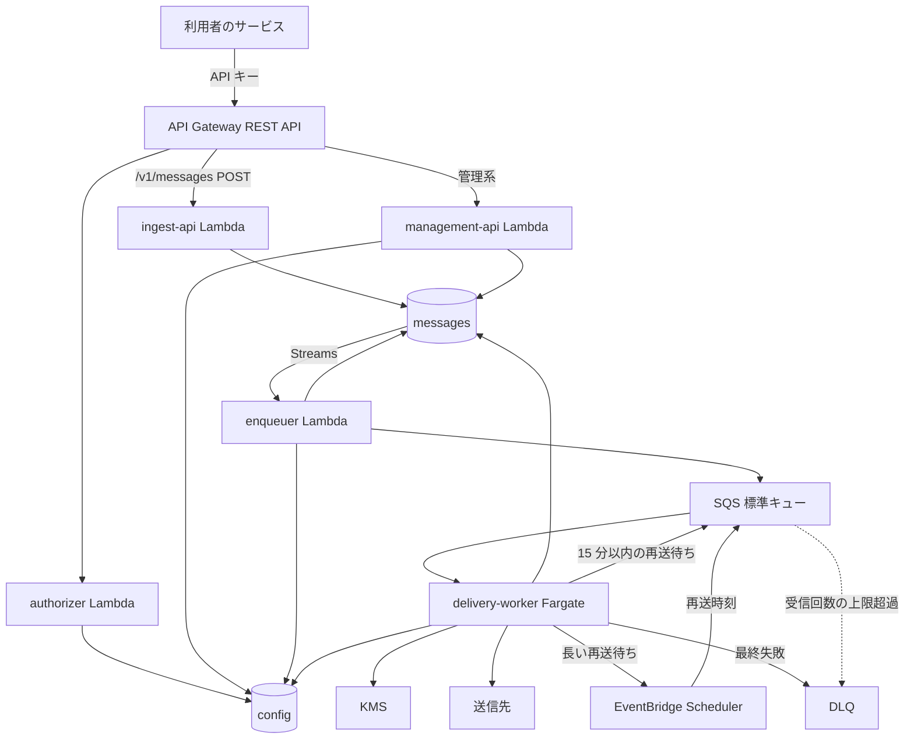
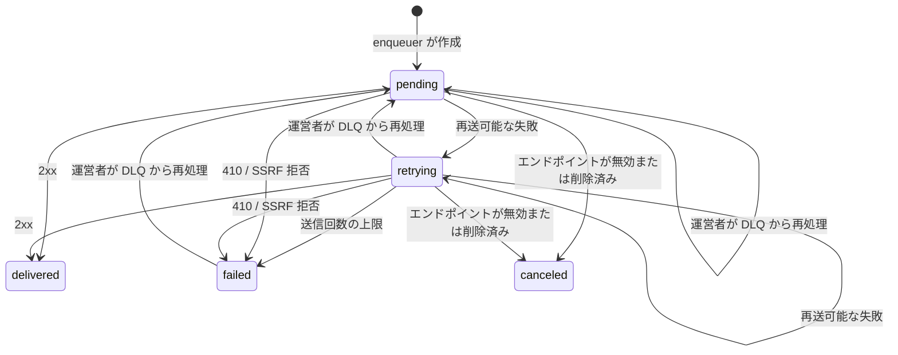

# アーキテクチャ

マルチテナント対応の Webhook 配信基盤の設計です。判断の理由は [ADR](adr/) に記録しています。

## 目標と範囲

**MVP に含むもの**

- 送信 API と、イベントタイプ購読による複数送信先への配信
- 再送、DLQ、署名、SSRF 対策、テナント間の分離
- エンドポイント登録、API キー発行、配信状況の参照を行う管理 API
- 運営者用のテナント作成スクリプト

**MVP に含まないもの**

- 管理画面、セルフサインアップ、API キーの権限分割
- 配信順序の保証、exactly-once 配信
- 失敗が続くエンドポイントの自動無効化（`410` 応答による無効化のみ行う）
- 管理 API からのメッセージ再送（DLQ の再処理は `scripts/` で行う）
- メッセージや失敗した配信の一覧 API（参照はメッセージ ID の指定のみ）
- 送信元 IP の固定、GCP 版

## 全体の流れ

| コンポーネント | 責務 |
|---|---|
| `authorizer` | API キーを検証し、テナント ID と使用量プラン用のキーを返す |
| `ingest-api` | 冪等性を確認し、メッセージを保存する |
| `management-api` | エンドポイント、API キー、配信状況を扱う |
| `enqueuer` | 購読先を調べて配信を作り、SQS へ投入する |
| `delivery-worker` | 署名して送信し、結果を記録して再送を制御する |
| `dummy-receiver` | 指定した応答や遅延を返す動作確認用の受信サーバー |

## ドメインモデル

- **テナント**: サービスの利用者。テナント ID がデータ分離の単位になる
- **エンドポイント**: 送信先。URL、購読するイベントタイプ、署名シークレット、固定ヘッダー、状態を持つ
- **メッセージ**: 起きた出来事。1 回の送信につき 1 件で、ペイロードを持つ
- **配信**: あるメッセージをあるエンドポイントへ届ける作業。状態と送信回数を持つ
- **試行**: 配信の 1 回分の送信結果

イベントタイプはドット区切りの文字列です（例：`order.created`）。各区切りは `[a-zA-Z0-9_]` のみ許可します。購読は完全一致で、ワイルドカードは扱いません。

## データモデル

DynamoDB のパーティションキーは必ずテナント ID から始めます。

### config テーブル

| アイテム | PK | SK | 主な属性 |
|---|---|---|---|
| テナント | `TENANT#<tenantId>` | `META` | 名前、使用量プラン用のキー |
| エンドポイント | `TENANT#<tenantId>` | `ENDPOINT#<endpointId>` | URL、`eventTypes`、暗号化シークレット（新旧）、暗号化固定ヘッダー、`status` |
| API キー | `TENANT#<tenantId>` | `APIKEY#<keyId>` | SHA-256 ハッシュ、作成日時、`status` |

API キーの形式は `whk_<tenantId>_<keyId>_<secret>` です。テナント ID と鍵 ID をキーに含めるので、GSI なしで `GetItem` できます。ハッシュは定数時間で比較します。

エンドポイントの `status` は `active` か `disabled` です。削除したエンドポイントはアイテムごと消すので、見つからないことが削除済みを表します。

### messages テーブル

TTL は属性 `expiresAt`（エポック秒）で、各アイテムを最初に書いた時刻から 30 日です（Terraform 変数で変更可）。更新では延ばしません。試行はメッセージより後に書くので、再送や再処理が続いた配信の試行は、メッセージより長く残ることがあります。メッセージが消えると API からは見えなくなります。

時刻は UTC の RFC 3339 文字列で保存します。各アイテムは種類を表す `itemType`（`message`、`delivery`、`attempt`）を持ちます。試行の SK の `attemptSeq` は、文字列の並びと番号の並びが一致するよう 6 桁にゼロ埋めします（例：`ATTEMPT#ep_1#000003`）。

| アイテム | PK | SK | 主な属性 |
|---|---|---|---|
| メッセージ | `TENANT#<tenantId>#MSG#<messageId>` | `META` | `itemType=message`、`type`、ペイロード、作成日時 |
| 配信 | `TENANT#<tenantId>#MSG#<messageId>` | `DELIVERY#<endpointId>` | `status`、`attemptCount`、`attemptSeq`、`nextAttemptAt`、`failureReason` |
| 試行 | `TENANT#<tenantId>#MSG#<messageId>` | `ATTEMPT#<endpointId>#<attemptSeq>` | 日時、結果、ステータスコード、所要時間 |
| 冪等キー | `TENANT#<tenantId>#IDEM#<key>` | `META` | `messageId`、本文のハッシュ、有効期限 |

パーティションキーにメッセージ ID を含めることで、1 テナントの書き込みが 1 パーティションに集中するのを防ぎます。

配信の状態遷移は次のとおりです。

- `attemptCount` は再送の判断に使う回数で、DLQ からの再処理で 0 に戻します。`attemptSeq` は試行履歴の通し番号で、戻しません
- `failureReason` は `retries_exhausted`、`gone`（`410`）、`ssrf_blocked` のいずれかで、`failed` のときだけ値を持ちます。DLQ に送るのは `retries_exhausted` のみです
- `canceled` は送信しないので、`attemptCount` と `attemptSeq` を増やしません

## API

すべて `Authorization: Bearer <API キー>` で認証します。

| メソッドとパス | 処理 |
|---|---|
| `POST /v1/messages` | メッセージを受け付け、`202` と ID を返す |
| `GET /v1/messages/{id}` | メッセージと配信状況、試行履歴を返す |
| `POST /v1/endpoints` | エンドポイントを登録し、シークレットを 1 回だけ返す |
| `GET`、`PATCH`、`DELETE /v1/endpoints/{id}` | エンドポイントの参照、更新、削除。`PATCH` で無効化された送信先を再度有効にできる |
| `GET /v1/endpoints` | エンドポイントの一覧 |
| `POST /v1/endpoints/{id}/rotate-secret` | 新しいシークレットを発行する |
| `POST /v1/api-keys` | API キーを発行し、平文を 1 回だけ返す |
| `DELETE /v1/api-keys/{id}` | API キーを失効させる |

ペイロードの上限は 256KB です。送信先の URL は `https` の 443 番のみ登録できます。再度有効にしても、無効の間に `canceled` になった配信は再送しません。

### 認証と流量制限

- API キーはハッシュのみ保存します
- オーソライザーの結果は 60 秒キャッシュするので、失効の反映に最大 60 秒かかります
- 使用量プランの流量制限には、利用者に見せない API Gateway キーをオーソライザーから返して使います（API キーソース `AUTHORIZER`）
- 最初のテナントとキーは、運営者がスクリプトで作成します

### 冪等性

- `Idempotency-Key` は任意で、テナント単位、24 時間有効です
- 同じキーで本文も同じ場合は、最初のメッセージ ID を返します
- 同じキーで本文が異なる場合は `409` を返します
- メッセージと冪等キーは同じトランザクションで保存します
- TTL の削除は遅れるので、有効期限はアプリケーションで比較します。期限切れのアイテムは条件付きで上書きします

## 配信の処理

### enqueuer

1. Streams のイベントフィルタで、`INSERT` かつ `itemType=message` のレコードだけを受け取る
2. テナントの有効なエンドポイントを検索し、イベントタイプで絞り込む
3. 配信を条件付きで作成する。既に存在すれば作成を省略して続行する
4. `{tenantId, messageId, endpointId}` を SQS に送る。`MessageGroupId` にはテナント ID を指定する

Lambda のイベントソースは `ReportBatchItemFailures` とバッチ分割を使い、失敗分だけを再実行します。再試行を尽くしたレコードの情報は失敗先のキューへ送り、運営者が `scripts/` で再処理します。

Streams の保持は 24 時間なので、`IteratorAge` と失敗先のキューを監視します。24 時間以内に復旧できなければ、未処理のメッセージは DynamoDB に残りますが、自動では配信されません。

### delivery-worker

1. SQS から受信し、配信レコードを読む。本文を読めないメッセージは削除せず、受信回数の上限で DLQ に隔離する
2. `delivered`、`canceled` なら、メッセージを削除して終了する
3. `failed` なら、`failureReason` が `retries_exhausted` のときだけ DLQ 送信からやり直し、メッセージを削除して終了する
4. `nextAttemptAt` より前なら、再送待ちを作り直してからメッセージを削除して終了する
5. エンドポイントを読み、無効または削除済みなら `canceled` を記録してメッセージを削除する
6. エンドポイントの同時送信数が上限なら、送信回数を増やさず、60 秒程度（ジッター付き）の遅延で送り直してメッセージを削除する
7. SSRF 検査を通して署名付きで送信する
8. 条件付き更新（`status` と `attemptCount` が読んだ値の場合のみ）で結果を記録する。配信の更新と試行の追加は 1 つのトランザクションで行い、一方だけが書かれることはない。`canceled` の記録も同じ条件で行う
9. 結果に応じて、削除、再送待ちの作成後に削除、または DLQ への送信後に削除を行う

1 件の処理には 80 秒の期限を付けます。キューの可視性タイムアウト 90 秒（「キューの設定」、ローカルは `local/elasticmq.conf`）より短くし、処理中の配信が再受信されないようにするためです。送信の期限 30 秒はこの中に収まります。可視性タイムアウトを変えるときは、この期限も合わせて見直します。

### 再送待ち

再送待ちのメッセージは「処理中」（in-flight）に置きません。一度キューから消し、再送時刻に入れ直します。

| 待ち時間 | 方法 |
|---|---|
| 15 分以内 | SQS の `DelaySeconds` を指定して送り直す |
| 15 分超 | EventBridge Scheduler の 1 回限りのスケジュールで、再送時刻に SQS へ投入する |

- 順序は、`nextAttemptAt` の記録、再送待ちの作成、元のメッセージの削除です。途中で失敗しても、再受信時に手順 4 で作り直します
- スケジュール名は、テナント ID、メッセージ ID、エンドポイント ID、`attemptSeq` のハッシュから決定的に作ります（64 文字以内）。同名のスケジュールが既にある場合の `ConflictException` は成功として扱うので、作成を繰り返しても重複しません
- 完了後は自動削除し（`ActionAfterCompletion=DELETE`）、投入の失敗は DLQ へ送ります
- Scheduler の SQS 用テンプレートの `MessageGroupId` は FIFO キュー向けと説明されているので、ユニバーサルターゲットで `SendMessage` を呼び、`MessageGroupId` を指定します
- 投入されたメッセージに Fair Queue が効くことは、実装時に AWS 上で確認します
- **暫定**: Scheduler を作るフェーズ 3 までは、15 分を超える待ちも SQS の `DelaySeconds` の上限 15 分で入れ直します。再受信したとき `nextAttemptAt` より前なら手順 4 で残りを待ち直すので、15 分ずつ刻んで待つことになります

### 応答の扱い

| 結果 | 動作 |
|---|---|
| `2xx` | `delivered` |
| `410` | エンドポイントを無効にし、`failed`。DLQ には送らない |
| `429`、`502`、`503`、`504` | 再送。`Retry-After` があれば、予定の間隔と比べて長い方を最大 12 時間まで採用 |
| `3xx`、その他の `4xx`、`5xx` | 再送。リダイレクトは追わない |
| タイムアウト（30 秒）、接続エラー | 再送 |
| SSRF 拒否 | `failed`。DLQ には送らず、エンドポイントも無効にしない |

`Retry-After` は秒数と日時の両方の形式を読みます。予定の間隔はジッターを加えた後の値で比べ、指定が長いときの待ち時間にはジッターを加えません。読めない値は指定なしとして扱います。12 時間の上限は指定だけにかかり、大きすぎる秒数にも適用します。

### 再送の間隔

送信は最大 8 回です。間隔は即時、5 秒、5 分、30 分、2 時間、5 時間、10 時間、10 時間で、合計は約 27 時間半です。各間隔に ±10% のジッターを加えます。

間隔は設定で差し替えられ、検証環境では短くできます。上限は送信の後に判断するので、一覧を短くした時点で上限を超えている `retrying` の配信は、もう 1 回送ってから `failed` になります。

### キューの設定

| 項目 | 値 | 理由 |
|---|---|---|
| キューの種類 | 標準（Fair Queue） | 順序保証は不要で、テナント間の公平性を得られる |
| 初期の可視性タイムアウト | 90 秒 | 送信タイムアウト 30 秒より十分長くする。ワーカーの 1 件の処理の期限 80 秒はこれより短くする |
| 受信回数の上限 | 20 回 | 待機のたびに新しいメッセージになるので正常な流れでは到達せず、壊れたメッセージは約 30 分で隔離できる |
| キューの保持期間 | 7 日 | 再送期間より長く、DLQ の 14 日より短い |
| DLQ の保持期間 | 14 日 | 自動移動では元の送信時刻が引き継がれるので、元のキューより長くする |

### 障害時の動作

前提は at-least-once です。DynamoDB を正とし、SQS は処理の合図として扱います。重複は許容し、受信側が `webhook-id` で判別します。

| 失敗する箇所 | その後の動作 | 結果 |
|---|---|---|
| DynamoDB の読み取り | 送信せず、再受信を待つ | 影響なし |
| 送信のタイムアウト | 失敗として再送する | 重複の可能性あり |
| 送信成功後の記録 | 削除せず、再受信時に再送する | 重複する |
| 送信失敗後の記録 | 回数を増やさず、再受信時に再送する | 1 回多く送る |
| 記録後の SQS 削除 | 再受信時に状態を見て削除のみ行う | 影響なし |
| 記録後の再送待ちの作成 | 再受信時に `nextAttemptAt` を見て作り直す | 影響なし |
| 再送待ちの作成後の削除 | 再受信時に作り直して削除する。SQS の遅延を使う場合は、まれに再送が重複する | 重複の可能性あり |
| `failed` 記録後の DLQ 送信 | 再受信時に DLQ 送信からやり直す | DLQ で重複の可能性あり |

DynamoDB の障害が長引く間は、ワーカーは受信を止めて待機します。それでも受信回数の上限に達した場合、メッセージは DLQ に移りますが、状態は更新されません。

**暫定**: 受信を止める動きはフェーズ 3 までは実装していません。障害の間も受信を続け、失敗したメッセージは削除しないので、長い障害では受信回数の上限で DLQ に移ります。復旧後に下の再処理で元のキューへ戻します。

次の場合は、やり直しても直らないのでメッセージを削除せずに残し、受信回数の上限で DLQ に隔離します。ログでは一時的な失敗と区別します。

- シークレットを復号できない（`ErrUndecryptable`）、または署名に使えない（`whsec_` 接頭辞がない、鍵の長さが範囲外）
- 配信、メッセージ、エンドポイントのアイテムがない（`ErrNotFound`）
- 保存値が壊れている（不正な ID、検証を通らない配信、メッセージ、エンドポイント）
- エンドポイントに固定ヘッダーがある（平文の形式が決まるまで送らない暫定）

条件付き更新が `ErrConflict` で失敗したときは、別のワーカーが先に記録したということなので、メッセージを削除せずに残します。再受信時に最新の状態を読み、手順 2〜4 で片付けます。

DLQ の再処理は運営者が `scripts/` で行います。配信を `pending` に、`attemptCount` を 0 に戻し、`nextAttemptAt` と `failureReason` を空にしてから元のキューへ送るので、再び最大 8 回送信します。対象は `retries_exhausted` で `failed` になった配信と、上記の障害で `pending` や `retrying` のまま DLQ に移った配信です。`delivered`、`canceled`、`gone` や `ssrf_blocked` の `failed` は、メッセージを削除するだけです。エンドポイントが無効または削除済みなら、通常の流れで `canceled` になります。

### テナント間の分離

- **流量**: 使用量プランでテナントごとに受付を制限します（ベストエフォート）
- **処理枠**: Fair Queue により、処理中のメッセージが多いテナントより他のテナントを優先します
- **送信先**: 1 タスクあたりの同時送信数を送信先ごとに制限します。上限はタスク単位で、全体の上限ではありません

## 署名とシークレット

- Standard Webhooks に準拠し、`webhook-id`、`webhook-timestamp`、本文を `.` で連結して HMAC-SHA256 で署名します
- `webhook-id` はメッセージ ID で、再送でも送信先ごとにも変わりません。`webhook-timestamp` は送信の時刻です
- シークレットはエンドポイントごとに発行します（`whsec_` 接頭辞、32 バイトのランダム値）
- 署名の前提は署名を作る処理だけで確かめます。`whsec_` 接頭辞のないシークレット、24〜64 バイトの範囲外の鍵、空または `.` を含むメッセージ ID はエラーにして、送信しません
- 暗号化には全テナント共通の KMS キーを使い、暗号化コンテキストにテナント ID とエンドポイント ID を含めます。別のエンドポイントのアイテムに暗号文を写しても復号できないので、他の送信先の鍵で署名することはありません
- ローカルでは KMS の代わりに AES-256-GCM を使い、追加の認証データ（AAD）に `TENANT#<tenantId>#ENDPOINT#<endpointId>` を入れて暗号化コンテキストと同じ効果を得ます。暗号文は nonce（12 バイト）と GCM の出力を連結したものです。鍵は `LOCAL_SECRET_KEY`（base64 の 32 バイト）で、ローカル専用の固定値を `compose.yaml` に置きます
- 復号結果はワーカーのメモリに 5 分保持します。`internal/app` の `CachedCipher` で `SecretCipher` を包んで実現し、エラーは保持しません。キャッシュのキーはテナント ID、エンドポイント ID、暗号文の組にします。暗号文が変わるので更新後の値はすぐに使われ、別のエンドポイントに写した暗号文がキャッシュに当たって復号の確認を飛ばすこともありません
- 更新後 24 時間は、新旧 2 つの署名を `webhook-signature` に併記します
- 固定ヘッダーも同じ方法で暗号化します。`webhook-*`、`Host`、`Content-Length` などは登録できません。固定ヘッダーは署名の対象外です

## SSRF 対策

1. URL が `https` で、ポートが 443 番であることを確認する
2. 配信のたびに DNS を 1 回解決する。ホストが IP リテラルなら、その IP を検査対象にする
3. 解決された IP をすべて検査する。1 つでも拒否範囲にあれば送信しない
4. 検査した IP にのみ接続する。TLS は元のホスト名で検証する
5. リダイレクトは追わない

接続処理は `http.Transport` の `DialContext` で実装し、検査済みの IP に接続します。多層防御として `net.Dialer` の `Control` でも接続直前の IP を検査します。リダイレクトは `CheckRedirect` で止め、環境変数のプロキシは使いません（`Proxy` は `nil`）。

**拒否範囲**: IPv4 のプライベート、ループバック、リンクローカル（`169.254.0.0/16`）、`100.64.0.0/10`、`0.0.0.0/8`、マルチキャストなどの非公開アドレス。IPv6 の `::1`、`fe80::/10`、`fc00::/7`、および IPv4 射影アドレス。IPv6 は公開用の `2000::/3` だけを許可し、その中でも 6to4、Teredo、文書用などは拒否します。IPv4 射影アドレスは、埋め込まれた IPv4 が公開アドレスでも拒否します。一覧は `internal/core/ssrf.go` にあります。

**例外**: `SSRF_ALLOWED_HOSTS` 環境変数（カンマ区切り）に指定したホストだけ、`http`、任意のポート、内部 IP を許可します。例外でないホストは `https` の 443 番だけです。完全一致のみで、既定は空です。ローカルの Docker Compose で使います。AWS の dev 環境の `dummy-receiver` は Lambda Function URL で公開するので、例外は不要です。

## インフラ

- **リージョン**: `ap-northeast-1`
- **環境**: `dev` のみ。tfstate は S3 に置き、`use_lockfile` でロックする（Terraform 1.11 以上）
- **Lambda**: OS のみのランタイム `provided.al2023`、arm64。実行ファイル名は `bootstrap`
- **ワーカー**: Fargate、arm64、パブリックサブネット、受信なし、送信は 443 番のみ。最小 0 台、最大 5 台（Terraform 変数で変更可）。dev は Fargate Spot
- **スケーリング**: SQS の受信可能数と処理中の数の合計に基づくステップスケーリング。再送待ちはどちらにも含まれないので、待ちしかなければ 0 台になる。0 台から動き出す最初の配信は数分遅れる
- **終了処理**: `SIGTERM` で受信を止め、処理中の配信を終えてから終了する
- **送信元 IP の固定**: 将来、フラグで NAT Gateway 経由に切り替える
- **CI/CD**: GitHub Actions から OIDC で認証する。PR で `plan`、`main` で `apply`

## 可観測性

- 構造化ログに `tenantId`、`messageId`、`endpointId` を含める。シークレットと本文は出力しない
- アラーム: DLQ のメッセージ数、キューの受信可能数の高止まり、enqueuer の `IteratorAge` と失敗先のキュー

## テスト

- **ユニット**: `core` の再送判定、署名、SSRF の範囲判定、イベントタイプの照合
- **統合**: DynamoDB Local と ElasticMQ によるアダプタと配信フロー。ElasticMQ は Fair Queue を再現しない前提で検証する。DynamoDB はテストごとのテナント ID で分け、キューはテストごとに一時キューを作って消す。エミュレーターが起動していなければ、スキップせずに失敗させる。テストの接続先と認証情報はローカル（`localhost:8000`、`localhost:9324`、ダミーの認証情報）に固定し、環境変数から受け継がない。AWS の認証情報があるシェルで実行しても、実環境に書き込まないようにする
- **負荷試験**: `loadtest/` で実施する。目標値は試験の設計時に決める

### dummy-receiver

送信先の代わりに、署名を検証してクエリで指定した応答を返します。使い方は `cmd/dummy-receiver/main.go` にあります。

- 署名は Standard Webhooks の公式 Go ライブラリで検証します。`core` の署名処理を使わないのは、署名側の誤りを受信側で打ち消さないためです。検証は常に必須で、`SIGNING_SECRETS` が空なら起動しません。署名なしの受信が `delivered` になると、検証できたと誤認するためです
- `SIGNING_SECRETS` にはシークレットを複数並べられ、どれかで通れば合格にします。送信先ごとの鍵の対応は見ないので、別の送信先の鍵で誤って署名しても通ります
- クエリは `status`（200〜599）、`delay`（60 秒まで）、`fail`（最初の 1〜8 回だけ `status` を返す）です。書き間違いに気づけるよう、知らない名前、重複、空の値、効果のない `fail`（2xx との組）は 400 にします
- 処理の順はクエリの検査、本文の読み取り（256KB まで）、署名の検証、回数の加算、遅延、応答です。400、401、405、413 はすぐに返し、`fail` の回数に含めません。配信側は再送するので、`attemptCount` は増えます
- `fail` の回数は `webhook-id` と URL の組ごとにメモリで数えます。`webhook-id` は送信先をまたいで同じなので、送信先ごとに別のパスを登録します。再起動で消え、Lambda ではインスタンス間で共有されないので、AWS 上では回数がずれることがあります
- ログに本文、シークレット、生のクエリは出しません。不正な入力は固定の理由コードで記録し、応答にも入力値を含めません

### ローカルのシード

登録 API がなくても通しを動かせるよう、`cmd/local-seed` が config テーブルにエンドポイントを直接書きます。Compose の初期化コンテナとして、テーブルの作成後に `docker compose up` のたびに動きます。

| エンドポイント | URL | `eventTypes` | `status` | 確かめること |
|---|---|---|---|---|
| `ep_ok` | `http://dummy-receiver:8080/ok` | `test.ok` | `active` | 1 回で届く |
| `ep_flaky` | `http://dummy-receiver:8080/flaky?fail=2&status=503` | `test.retry` | `active` | 2 回失敗し、再送で届く |
| `ep_disabled` | `http://dummy-receiver:8080/disabled` | `test.ok` | `disabled` | 配信が作られない |

- テナントは `t_local` だけです。テナントの `META` と API キーはまだ読む処理がないので書きません
- シークレットは全エンドポイントで同じ 1 つの値で、`dummy-receiver` の `SIGNING_SECRETS` と同じ値を `compose.yaml` の 1 か所から渡します
- 毎回同じ値で上書きするので、手で無効にしたエンドポイントも次の起動で元に戻ります
- 接続先が `localhost`、`127.0.0.1`、`dynamodb` 以外なら起動しません。認証情報はダミーに固定し、環境変数から受け継ぎません。AWS の認証情報があるシェルで実行しても、実環境に書き込まないようにするためです
- 送信先は `http` の 8080 番ですが、compose の delivery-worker が `SSRF_ALLOWED_HOSTS=dummy-receiver` で SSRF の例外にして送ります

## クラウド間の移植

`internal/core` は次のポートを Go のインターフェースとして定義し、`internal/adapters/aws` が実装します。`core` からの AWS SDK の参照は、`golangci-lint` の `depguard` で禁止します。再送の判断は `core` が行い、アダプタは指定された遅延の実現だけを担います。

| ポート | 責務 |
|---|---|
| `MessageRepository` | メッセージの作成と取得、配信の作成、取得、条件付き更新、試行の記録 |
| `EndpointRepository` | エンドポイントの取得、テナントの有効なエンドポイントの一覧、無効化 |
| `DeliveryPublisher` | 遅延付きの投入（上限 15 分）、DLQ への送信 |
| `DeliveryConsumer` | 受信、確認応答 |
| `SecretCipher` | シークレットと固定ヘッダーの暗号化と復号。テナント ID とエンドポイント ID（`SecretContext`）を暗号化コンテキストにする |
| `WebhookSender` | SSRF 検査済みの接続処理で Webhook を送る。クラウドに依存しないので `internal/adapters/httpsender` が実装する |

- 現在時刻は `func() time.Time` として注入し、テストでは固定した時刻を返す関数を渡します
- 配信は `DeliveryKey`（テナント ID、メッセージ ID、エンドポイント ID）で指します。SQS の本文も同じ 3 つの JSON です。ID は空や `#` を含むものを拒否し、キーの連結で他のテナントのアイテムを指せないようにします
- 配信の更新には、読んだ値と新しい値の両方を渡します。アダプタは読んだ値の `status` と `attemptCount` から条件を作ります
- アダプタは `core` の `ErrNotFound`（アイテムがない）、`ErrConflict`（条件付き書き込みの失敗）、`ErrDelayTooLong`（キューの遅延の上限超え）、`ErrInvalidKey`（不正な ID）、`ErrUndecryptable`（暗号文をそのコンテキストで復号できない）を返します。`ErrUndecryptable` は改ざん、コンテキストの不一致、鍵の違いを区別せず、何度やり直しても成功しない失敗を表します。それ以外の `SecretCipher` のエラー（KMS への通信失敗など）は一時的なものとして扱えます。`WebhookSender` は SSRF 検査で送らなかったときに `ErrSSRFBlocked` を返します。呼び出し側は SDK の型を見ません。15 分を超える待ちは呼び出し側が Scheduler で作ります
- 受信した本文を読めなければ、その 1 件だけをエラーとして返します。同じバッチの他のメッセージは処理します

GCP 版の具体的なサービス構成は、AWS 版の完成後に決定します。

### 保存値の検証

DynamoDB の値はアダプタで検証してから `core` に渡します。必須の属性がなければエラーにします。SDK は欠けた属性をゼロ値で埋めるので、0 と属性なしを区別するためです。そのうえで `core` の検証（配信は `RestoreDelivery`、メッセージとエンドポイントは `Validate`）を通します。テナントのエンドポイントの一覧に壊れたものが 1 件でもあれば、一覧全体をエラーにします。壊れた送信先を除いて進めると、その送信先への配信が作られず、後から取り返せないためです。そのため、一覧は `status` で絞り込まずに読み、すべてを検証してから `active` のものを残します。DynamoDB 側で絞り込むと、壊れた値が検証に届く前に除かれるためです。

### 設定

接続先は SDK 標準の環境変数（ローカルでは `AWS_ENDPOINT_URL_DYNAMODB`、`AWS_ENDPOINT_URL_SQS`）で切り替えます。テーブル名、キューの URL、保持期間は `MESSAGES_TABLE`、`CONFIG_TABLE`、`DELIVERY_QUEUE_URL`、`DELIVERY_DLQ_URL`、`MESSAGE_RETENTION` から読みます。既定値はなく、各コマンドは自分が使う値が 1 つでも欠ければ起動しません。読むのは `cmd/` で、アダプタは値を引数で受け取ります。ローカル用の `SecretCipher` の鍵は `LOCAL_SECRET_KEY`、シードが書くシークレットの平文は `SEED_SIGNING_SECRET` から読みます。

delivery-worker は任意で次の 2 つも読みます。一覧と形式は `cmd/delivery-worker/main.go` にあります。

- `SSRF_ALLOWED_HOSTS`: SSRF 検査の例外にするホスト名（カンマ区切り）。既定は空
- `RETRY_SCHEDULE`: 再送の間隔（カンマ区切りの `time.ParseDuration` 形式、各値は 0 より大きい）。未設定なら「再送の間隔」の既定値。compose では 1 秒を 7 個にして、送信回数の上限 8 回を保ったまま再送を待たずに確かめます
